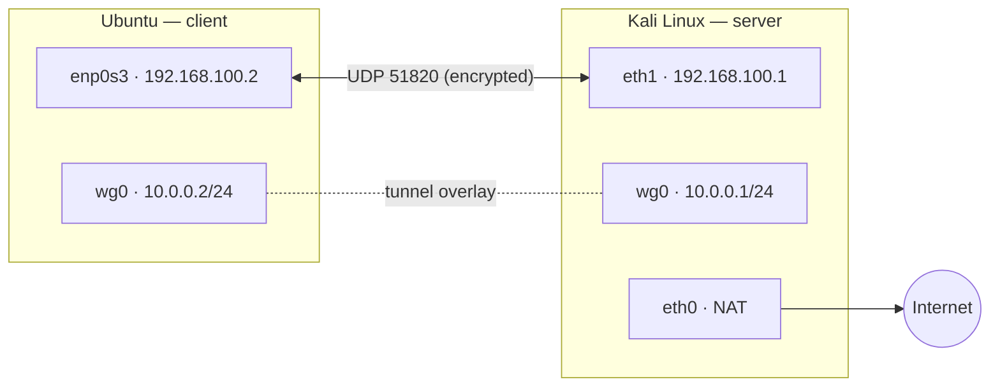
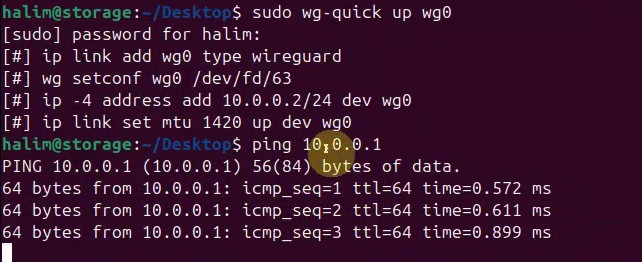
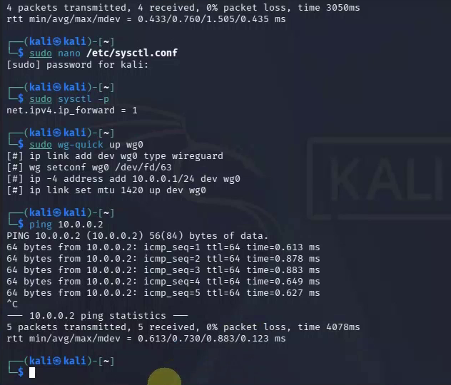
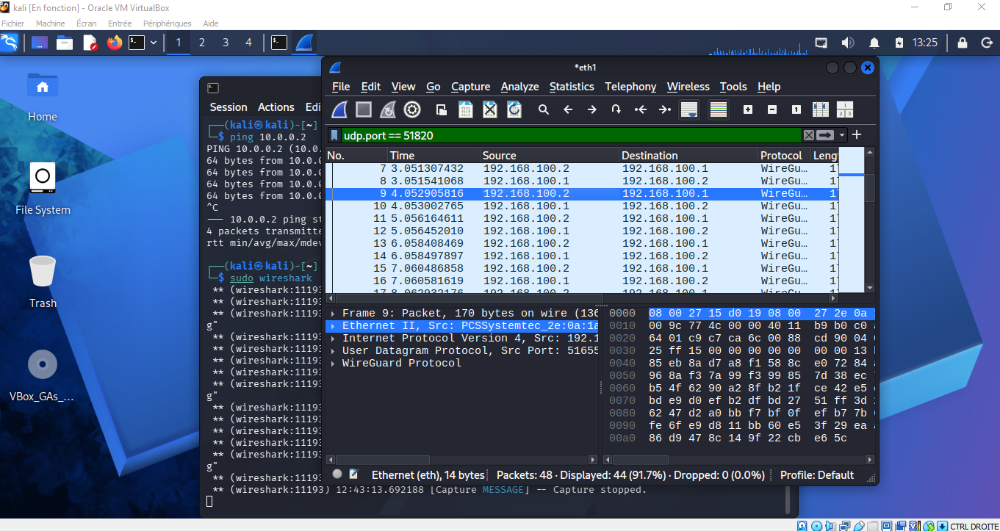
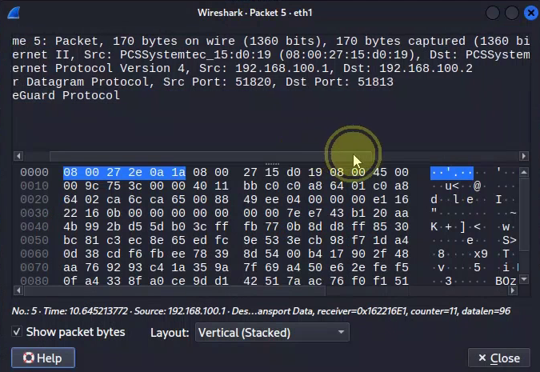

# WireGuard VPN Lab — Kali Linux ⇄ Ubuntu (VirtualBox)

A site-to-site style **WireGuard VPN tunnel between two Linux VMs**, verified with ping through the tunnel and **Wireshark packet analysis** proving the traffic is encrypted.

> Mini-project, ARSI 2nd year (Network Administration & Security) — Institut International de Technologie, 2025/2026.
> Authors: **KALLEL Halim**, **TOUMI Karim** · Supervisor: MASSAOUDI Aymen
> Full write-up (French): [`report/Rapport_VPN_WireGuard_ARSI2_FR.pdf`](report/Rapport_VPN_WireGuard_ARSI2_FR.pdf)

## Highlights

- Built a WireGuard tunnel (`wg0`, `10.0.0.0/24`) between a Kali server and an Ubuntu client over a VirtualBox internal network
- Generated Curve25519 key pairs, wrote the peer configs and enabled IP forwarding on the server
- Validated the tunnel with ICMP in **both directions through `10.0.0.x`**
- Captured the underlay with Wireshark: WireGuard `Transport Data` packets over **UDP/51820**, payload opaque

## Architecture



| Interface | Host | Address | Role |
|---|---|---|---|
| `eth1` | Kali | 192.168.100.1/24 | VirtualBox internal network (underlay) |
| `enp0s3` | Ubuntu | 192.168.100.2/24 | VirtualBox internal network (underlay) |
| `wg0` | Kali | 10.0.0.1/24 | WireGuard tunnel (server) |
| `wg0` | Ubuntu | 10.0.0.2/24 | WireGuard tunnel (client) |

**Stack:** WireGuard (wireguard-tools 1.0.20250521) · Kali Linux · Ubuntu · Oracle VirtualBox · Wireshark 4.6.4 · iptables · netplan

## Setup in short

```bash
# 1. Install (both machines)
sudo apt update && sudo apt install wireguard -y

# 2. Keys (each machine generates its own; share ONLY the public key)
bash scripts/generate-keys.sh server    # on Kali
bash scripts/generate-keys.sh client    # on Ubuntu

# 3. Configs: copy configs/*.example to /etc/wireguard/wg0.conf and fill in the keys

# 4. Kali: forwarding + NAT (details in the script)
sudo bash scripts/server-setup.sh eth0

# 5. Start the tunnel (both machines) and enable at boot
sudo wg-quick up wg0
sudo systemctl enable wg-quick@wg0

# 6. Test through the tunnel
ping 10.0.0.2      # from Kali
ping 10.0.0.1      # from Ubuntu
```

Config templates: [`configs/`](configs/) (placeholders only, no real keys).

## Results

### Tunnel brought up (`wg-quick up wg0`)
`wg-quick` creates the `wg0` interface, loads the config, assigns the tunnel IP and sets MTU 1420.

| Kali | Ubuntu |
|---|---|
|  |  |

### Ping through the tunnel (both directions, 0 % loss, ~0.6 ms)
Kali → `10.0.0.2`: 5/5 replies. Ubuntu → `10.0.0.1`: replies shown right after `wg-quick up`.



### Wireshark: the traffic on the wire is encrypted
Filter `udp.port == 51820` on Kali's internal interface: only `WireGuard` packets between the **underlay** addresses 192.168.100.1 and 192.168.100.2. No ICMP is visible, because the pings travel inside the encrypted payload.



Opening one packet shows a WireGuard **Transport Data** message (receiver index, counter, encrypted payload) with no readable content:



More evidence: [`screenshots/`](screenshots/).

## How it works (what I learned)

- WireGuard identifies peers by public key; `AllowedIPs` acts as both routing table and access filter (cryptokey routing).
- Handshake and data use Curve25519, ChaCha20-Poly1305 and BLAKE2s over **UDP only**.
- `PersistentKeepalive = 25` keeps the tunnel alive behind NAT/firewalls; keepalives show up as short packets in the capture.
- Underlay vs overlay: a ping to `192.168.100.x` does *not* prove the VPN works, only a ping to `10.0.0.x` does. Wireshark shows the underlay, where overlay traffic is hidden.
- Private keys stay on their own machine and are never committed (see `.gitignore`).

## Limitations and next steps

- The report's first two ping figures (03, 04) test the **underlay** (`192.168.100.x`) and prove connectivity of the lab network, not the tunnel. The tunnel tests are screenshots 08 and 09.
- The server has IP forwarding and a NAT rule configured, but routing client Internet traffic through the VPN (`AllowedIPs = 0.0.0.0/0`) was not tested; the client uses split tunnelling for `10.0.0.0/24` only.
- The Wireshark captures were taken on Kali's internal interface (`eth1`); `eth0` is the NAT adapter.
- No `wg show` capture (handshake/transfer counters) was kept from the lab; tunnel proof relies on the pings and the Wireshark capture.
- Ideas: multiple clients, cloud deployment (AWS/Azure/OVH), Ansible automation, nftables hardening.

## Repository layout

```
.
├── README.md
├── LICENSE
├── configs/        placeholder configs (server, client, network)
├── scripts/        key generation and server setup helpers
├── screenshots/    evidence (install, tunnel, pings, Wireshark)
└── report/         full project report (French, PDF)
```

## License
MIT — see [LICENSE](LICENSE).
